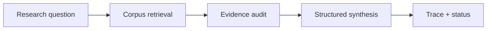

# Agentic-Research-Assistant

**Deterministic research workflow with evidence auditing**

 

## Overview

Deterministic research workflow with evidence auditing. This compact, dependency-free Python baseline is intended for reproducible experimentation and extension.

## Architecture



## Quick start

```bash
git clone https://github.com/rohanst14/Agentic-Research-Assistant.git
cd Agentic-Research-Assistant
python -m pip install -e .
python examples/demo.py
python -m unittest discover -s tests -v
```

## Example

```python
from agentic_research_assistant import *
result = run('reactor pressure',{'paper':'reactor pressure changes with temperature'})
print(result)
```

## Repository guide

| Path | Purpose |
|---|---|
| [src/agentic_research_assistant](src/agentic_research_assistant) | Core implementation |
| [examples/demo.py](examples/demo.py) | Runnable synthetic demonstration |
| [tests/test_core.py](tests/test_core.py) | Regression tests |
| [docs/methodology.md](docs/methodology.md) | Method and limitations |

## Limitations

Deterministic orchestration baseline; not an autonomous LLM agent or live literature search.

This is an AI-assisted portfolio prototype, not a production system or published scientific result.
